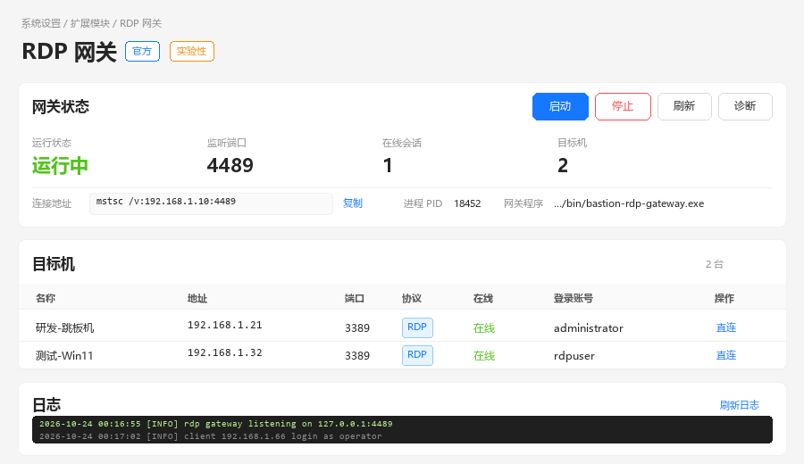

# RDP 网关 · RDP Gateway

> 官方扩展模块（`id: rdp-gateway`，`experimental: true`）——把原本内置在宿主里的实验性 RDP 网关解耦成可独立安装、启停、配置和卸载的 `.mod.ops_ext` 组件包。

用户在 Windows 上直接用 `mstsc` 连接堡垒机，登录后选择自己**有访问授权**的 RDP 主机，所有会话写入 `SessionRecord` 与审计流水。网关本体是一个独立的 Rust 进程（`bastion-rdp-gateway.exe`），由本模块负责生命周期；宿主只承担登录、资产授权、会话记录和审计。



## 功能

- **独立进程**：网关 exe 与宿主 Flask 进程隔离，崩溃/重启宿主不会连带网关（反之亦然）。
- **幂等启停**：重复启动不会产生僵尸进程；端口被占用返回 `409 PORT_IN_USE`；进程意外退出后 `status` 能立即反映。
- **完整页面**：模块自带 js 模式页面，直接使用宿主注入的 React + antd 组件，与堡垒机其它页面视觉一致；提供状态、目标机、会话、参数设置和日志面板。
- **模块设置**：`enabled` / `port` / `autoStart` 三个设置全部通过模块命名空间 `mod.rdp-gateway.*` 持久化，不再读写宿主的 `rdp_gateway_*`。
- **审计不丢**：打开会话、取用凭据、启动/停止网关都会写宿主审计。
- **可观测**：exe 的 stdout/stderr 落到 `data/gateway.log`，同时转发到模块 logger（宿主 `GET /api/modules/rdp-gateway/logs` 可取到最近 200 行）。
- **停用即清理**：停用/卸载/宿主退出（`atexit`）都会 `taskkill /T /F` 结束网关进程树。

## 包结构

```
rdp-gateway/
├── description.json          # 模块清单（id/version/nav/settings/permissions）
├── modules/
│   ├── __init__.py           # setup / on_enable / on_disable / teardown（只做装配）
│   ├── gateway.py            # 进程生命周期、设置、日志、诊断
│   ├── targets.py            # 授权 RDP 资产、建立会话 + 审计
│   └── bridge.py             # 浏览器画面桥接（connect/frame/input/disconnect/close）
├── web/
│   └── index.js              # js 模式页面（React.createElement + 宿主注入的 antd，无构建/无 CDN）
├── images/demo-1.png
├── bin/bastion-rdp-gateway.exe   # 发布包内附带；git 中忽略（约 14MB）
└── README.md
```

## 安装

在「系统设置 → 扩展模块」页面上传 `modules-dist/rdp-gateway-1.1.0.mod.ops_ext`；因为是实验性模块，弹窗会要求逐字确认：

```
我知道这是实验性功能，使用不当的话也许会造成系统损毁
```

安装后模块默认启用。也可以走 API（需要管理员 token）：

```bash
curl -X POST http://127.0.0.1:5000/api/modules/install \
  -H "Authorization: Bearer <admin-token>" \
  -F "file=@modules-dist/rdp-gateway-1.1.0.mod.ops_ext" \
  -F "ack=我知道这是实验性功能，使用不当的话也许会造成系统损毁"
```

启用后左侧导航出现「RDP 网关」，页面地址为 `/m/rdp-gateway/rdp-gateway`。模块 API 统一挂在：

```
/api/modules/rdp-gateway/api/...
```

## 设置

| 键 | 类型 | 默认 | 说明 |
| --- | --- | --- | --- |
| `mod.rdp-gateway.enabled` | bool | `1` | 关闭后立即停止网关进程，且拒绝再次启动 |
| `mod.rdp-gateway.port` | int (1–65535) | `4489` | mstsc 连接端口；运行中修改会停止网关，需重新启动 |
| `mod.rdp-gateway.autoStart` | bool | `0` | 模块加载/启用时自动拉起网关 |

设置接口：`GET/POST /api/modules/rdp-gateway/api/settings`（`POST` 需管理员）。

## HTTP API

全部路径以 `/api/modules/rdp-gateway/api` 为前缀；错误信封与宿主一致：

```json
{ "success": false, "message": "…", "code": "PORT_IN_USE", "data": null }
```

| 方法 | 路径 | 权限 | 说明 |
| --- | --- | --- | --- |
| GET | `/status` | `rdp:use` | 运行状态、端口、PID、exe、本机 IP、连接串 |
| GET | `/settings` | `rdp:use` | 读取三个模块设置 |
| POST | `/settings` | `rdp:use` + 管理员 | 保存设置；运行中改端口/停用会自动停网关 |
| POST | `/start` | `rdp:use` + 管理员 | 启动网关（幂等） |
| POST | `/stop` | `rdp:use` + 管理员 | 停止网关（幂等） |
| GET | `/diagnose` | `rdp:use` + 管理员 | 路径、候选二进制、端口占用、日志尾部 |
| GET | `/logs?lines=300` | `rdp:use` | 网关输出日志尾部 |
| GET | `/hosts` | `rdp:use` | 当前用户有授权的 RDP 资产 |
| POST | `/sessions` | `rdp:use` | 建立会话记录并返回一次性连接凭据 |
| POST | `/connect` | `rdp:use` | 打开浏览器画面桥 |
| GET | `/frame?sid=…` | `rdp:use` | 拉取一帧画面（无可拉帧时 `204`） |
| POST | `/input` | `rdp:use` | 转发鼠标/键盘事件 |
| POST | `/disconnect` | `rdp:use` | 关闭浏览器画面桥（Rust 客户端回选单时调用） |
| POST | `/sessions/<sid>/close` | `rdp:use` | 模块页面「断开」：关桥并把会话记录收口为 `closed` |

管理动作在视图内部用 `load_actor()` + `is_admin()` 校验，非管理员返回 `403 ADMIN_ONLY`；未登录返回 `401 UNAUTHORIZED`。之所以不在 `ctx.route(permission=...)` 上直接写 `admin`，是因为模块路由的 `permission` 只接受一个权限码，管理员语义由视图兜底。

## 进程与环境变量

模块启动 exe 时会注入：

| 变量 | 值 |
| --- | --- |
| `RDP_GATEWAY_PORT` | 模块设置里的端口 |
| `BASTION_INSTANCE_DIR` | 模块 `data_dir`（pid/runtime 文件也在这里） |
| `BASTION_API_BASE` | `http://127.0.0.1:<宿主端口>`（优先取当前请求的 host） |
| `BASTION_API_PREFIX` | `/api/modules/rdp-gateway/api` |
| `RUST_LOG` | 未设置时 `info` |

查找 exe 的顺序：`BASTION_RDP_GATEWAY_BIN` 环境变量 → 包内 `bin/bastion-rdp-gateway.exe` → 源码树 `bastion-rdp-gateway/target/release/`。找不到时 `start` 返回 `400 BINARY_MISSING`，`status.binaryExists` 为 `false`，页面给出提示。

## 构建二进制

```powershell
# 需要 MSVC（x64 Native Tools）与 cargo
cd bastion-rdp-gateway
cargo build --release
copy target\release\bastion-rdp-gateway.exe ..\modules-src\rdp-gateway\bin\
```

发布包必须包含 `bin/bastion-rdp-gateway.exe`；该文件被 `.gitignore` 忽略，不提交进 git。打包工具不会读取 `.gitignore`，因此本地 `tools/pack_module.py` 仍会把它装进 `.mod.ops_ext`。

## 卸载

在模块页面「停用」会先停网关进程、关闭所有浏览器画面桥；「卸载」删除模块目录与 `mod.rdp-gateway.*` 设置。卸载不会删除 `data/gateway.log`，便于事后排查。

## 已知限制

- 仅支持 Windows 作为**网关运行平台**（`CREATE_NO_WINDOW` / `taskkill`），管理页面可在任意平台打开。
- 页面以 `mstsc /v:<IP>:<端口>` 直连为主；`/connect`、`/frame`、`/input` 画面桥接口仍保留，但页面不再内置画面查看器。
- 会话凭据只在 `POST /sessions` 响应中出现一次，页面关闭后无法再次查看；重新连接请重新建立会话。
